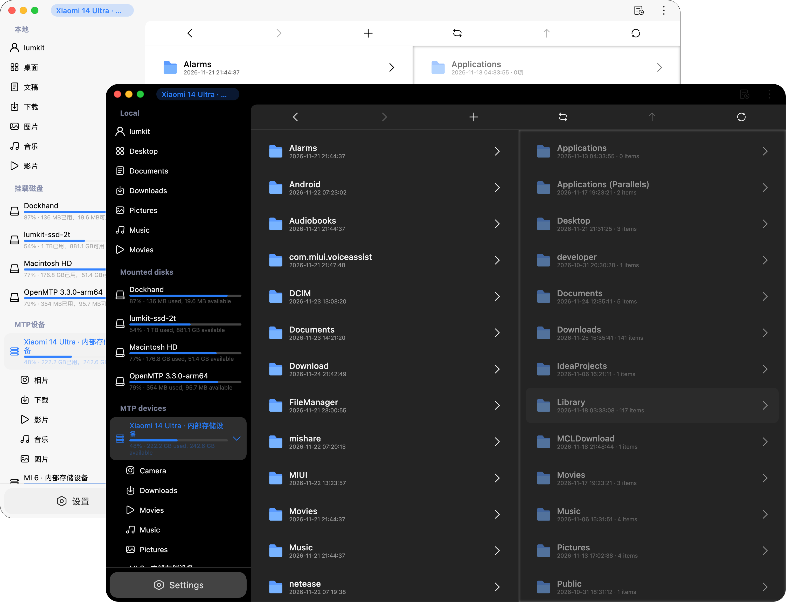

# Dockhand

A fast, native-feeling dual-pane file browser for macOS.

Browse, compare, and transfer files between two panes, and manage Android devices over MTP — all in one window.

[中文文档](README.zh-CN.md)

## Features

### Dual-pane workflow

- Two independent panes with separate history and navigation
- Quickly copy or move selected items to the other pane
- Open either pane in Terminal
- Restore the last location and window size on launch

### File management

- Copy, move, rename, delete, and move to Trash
- Create ZIP, 7z, TAR, TAR.GZ, TAR.XZ, TAR.BZ2, TAR.ZST, GZIP, XZ, and ZSTD archives
- Optional passwords for ZIP/7z and split archives for ZIP
- Batch operations for multiple selections
- Batch rename with predictable numbered names
- Background tasks with live progress, speed, ETA, and cancellation
- System notifications when background tasks finish
- Automatic refresh of both panes after operations

### Selection and keyboard

- Single click, Command-click, and Shift-click selection
- Drag a rectangle to select multiple items
- Shift + arrow keys to extend or shrink a selection in list and grid views
- Previous/next item navigation with configurable shortcuts
- Customizable shortcut mappings, including multiple shortcuts per action

### Views and organization

- Linear list and adaptive grid layouts
- Sort by name, modification date, size, or type
- Ascending and descending order
- Show or hide hidden files from the More menu
- File type icons and image/video thumbnails

### Previews

- Image thumbnails for common formats
- SVG previews
- Video cover thumbnails
- Graceful fallback to file type icons when previews are unavailable

### Android MTP

- Browse compatible Android devices directly in either pane
- Storage and common media folders in the sidebar
- Paged loading for large directories
- Copy files between local folders and MTP devices
- Multiple devices are handled independently

### Appearance and settings

- Light, dark, and system appearance
- Custom accent color
- Interface scale adjustment
- Hidden item visibility
- Configurable startup behavior
- Cache size display and deferred cache cleanup

## Performance

Dockhand is designed to stay responsive with large folders:

- File lists render lazily instead of building the entire view at once
- Large remote directories load page by page while scrolling
- Thumbnails are generated on demand and cached
- File transfers run in the background and can be cancelled
- Long-running work never blocks browsing

## Requirements

- macOS 12 or later
- Apple Silicon Mac for the current release
- An Android device with MTP support is optional

## Download

Download the latest macOS DMG from GitHub Releases:

**[Download Dockhand](https://github.com/lumkit/dockhand/releases/latest)**

## Installation

1. Download the latest `.dmg`.
2. Open the DMG.
3. Drag **Dockhand** into **Applications**.
4. Launch Dockhand from Applications.

## Help Translate

Dockhand currently ships with Simplified Chinese and English (US). Native speakers are welcome to help improve these translations or add new languages.

If you would like to contribute a translation, open an issue with the language you would like to add:

<https://github.com/lumkit/dockhand/issues>

## Feedback

Found a bug or have a feature request?

- Open an issue: <https://github.com/lumkit/dockhand/issues>
- Include your macOS version, Dockhand version, and steps to reproduce when possible.

## Privacy

- No account is required.
- Your files stay on your Mac or connected device.
- Dockhand does not upload your files.

## License

Licensed under the [Apache License, Version 2.0](LICENSE).

Copyright 2026 lumkit.
