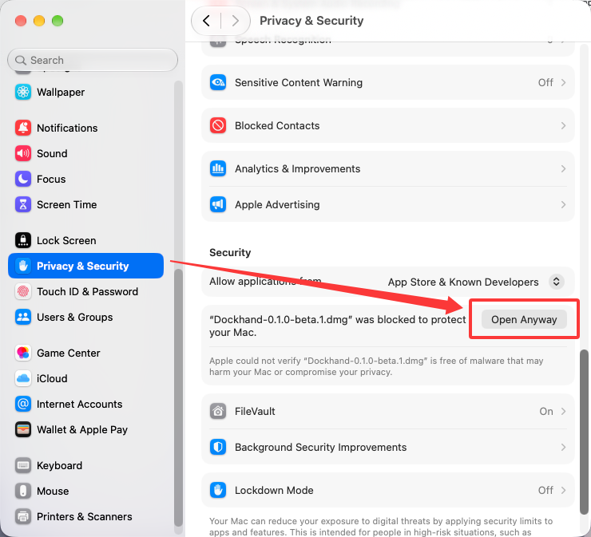

# Dockhand

A fast, native-feeling dual-pane file browser for macOS.

Browse, compare, and transfer files between two panes, and manage Android devices over MTP — all in one window.

[中文文档](README.zh-CN.md)

## Features

### Dual-pane workflow

- Two independent panes with separate history and navigation
- Quickly copy or move selected items to the other pane
- Local folders, mounted volumes, iCloud Drive, and MTP devices in the sidebar
- Open either pane in Terminal
- Restore the last location and window size on launch

### File management

- Copy, move, rename, delete, and move to Trash
- Copy selected items to the system clipboard; paste files copied from Finder or other apps after confirmation
- Create ZIP, 7z, TAR, TAR.GZ, TAR.XZ, TAR.BZ2, TAR.ZST, GZIP, XZ, and ZSTD archives
- Extract those formats by double-clicking or from the context menu
- Optional passwords for ZIP/7z and split archives for ZIP
- Batch operations for multiple selections
- Batch rename with predictable numbered names
- Background tasks with live progress, speed, ETA, and cancellation
- System notifications when background tasks finish
- Automatic refresh of both panes after operations

### Drag and drop

- Drop files or folders from other apps onto either pane to copy or move them into that folder
- The target pane shows an overlay with the destination and pending action
- Long-press selected items and drag them to Finder, another app, or the opposite pane
- Copy and move behavior follows the drop target and the modifier keys

### Selection and keyboard

- Single click, Command-click, and Shift-click selection
- Drag a rectangle to select multiple items
- Shift + arrow keys to extend or shrink a selection in list and grid views
- Previous/next item navigation with configurable shortcuts
- Customizable shortcut mappings, including multiple shortcuts per action
- System clipboard copy/paste, with readable key labels in shortcut settings
- Global shortcuts pause while the search field has focus, then resume when it loses focus

### Views and organization

- Linear list and adaptive grid layouts
- Per-folder sort modes, with Name A-Z as the default
- Sort by name, modification date, size, or type, ascending or descending
- Apply the focused folder's sort mode to every other folder and make it the new default
- Show or hide hidden files from the More menu
- File type icons, real macOS app icons, and image/video thumbnails

### macOS apps

- App icons appear on both list and grid items
- Launch an app from its context menu, or open/double-click it to run it
- Apps open through the same system launcher as Finder

### Search

- Search the focused folder or include all subfolders
- Filter results by all items, files, or folders
- Results replace the file list and follow the current sort mode and list/grid layout
- Live match count, search progress, and a clear exit action

### Previews

- Image thumbnails for common formats
- SVG previews
- Video cover thumbnails
- Graceful fallback to file type icons when previews are unavailable

### Android MTP

- Browse compatible Android devices directly in either pane
- Storage and common media folders in the sidebar
- Paged loading for large directories
- Copy files between local folders and MTP devices
- Multiple devices are handled independently

### Appearance and settings

- Light, dark, and system appearance
- Custom accent color
- Interface scale adjustment
- Hidden item visibility
- Configurable startup behavior
- Cache size display and deferred cache cleanup

### Updates

- Checks GitHub Releases for a newer version shortly after launch
- Shows a badge and the release notes when an update is available
- Opens the download page or lets you ignore a specific version

## Performance

Dockhand is designed to stay responsive with large folders:

- File lists render lazily instead of building the entire view at once
- Large remote directories load page by page while scrolling
- Thumbnails are generated on demand and cached
- File transfers run in the background and can be cancelled
- Long-running work never blocks browsing

## Requirements

- macOS 12 or later
- Apple Silicon Mac for the current release
- An Android device with MTP support is optional

## Download

Download the latest macOS DMG from GitHub Releases:

**[Download Dockhand](https://github.com/lumkit/dockhand/releases/latest)**

## Installation

1. Download the latest `.dmg`.
2. Open the DMG.
3. Drag **Dockhand** into **Applications**.
4. Launch Dockhand from Applications.

> **Code signing notice**
>
> Release packages are currently signed with an Apple Development certificate rather than a Developer ID Application certificate, and have not been notarized by Apple. Consequently, macOS Gatekeeper may present a security warning when the application is launched for the first time. This behavior is expected for the current beta release. Please confirm that the package was obtained from the official GitHub Releases page, then Control-click the application in Finder, select **Open**, and confirm the prompt. Do not disable Gatekeeper globally.
>
> If macOS blocks the DMG, open **System Settings → Privacy & Security → Security**, locate the blocked Dockhand message, click **Open Anyway**, authenticate, and open the DMG again.

## Help Translate

Dockhand currently ships with Simplified Chinese and English (US). Native speakers are welcome to help improve these translations or add new languages.

If you would like to contribute a translation, open an issue with the language you would like to add:

<https://github.com/lumkit/dockhand/issues>

## Feedback

Found a bug or have a feature request?

- Open an issue: <https://github.com/lumkit/dockhand/issues>
- Include your macOS version, Dockhand version, and steps to reproduce when possible.

## Privacy

- No account is required.
- Your files stay on your Mac or connected device.
- Dockhand does not upload your files.
- Update checks request public release metadata from GitHub Releases; no file contents or account details are sent.

## License

Licensed under the [Apache License, Version 2.0](LICENSE).

Copyright 2026 lumkit.
