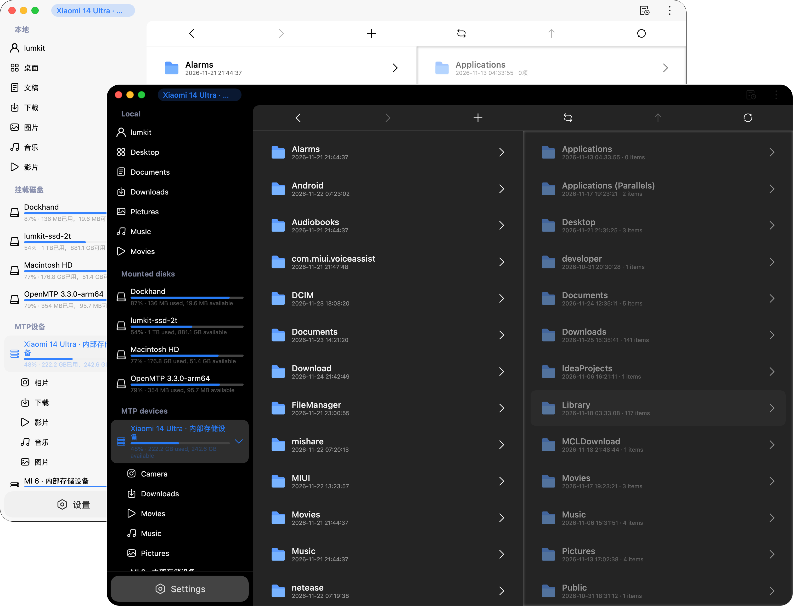

# Dockhand

一款快速、贴近 macOS 原生体验的双栏文件浏览器。

在一个窗口里浏览、比较和传输文件，并直接管理通过 MTP 连接的 Android 设备。

[English](README.md)

## 功能

### 双栏工作流

- 两个独立面板，各自保留前进后退历史
- 快速把选中内容复制或移动到另一侧
- 在任意面板当前目录打开终端
- 启动时恢复上次路径和窗口大小

### 文件管理

- 复制、移动、重命名、删除、移到废纸篓
- 多选后执行批量操作
- 批量重命名，自动生成有序编号
- 后台任务展示实时进度、速度、剩余时间和取消入口
- 后台任务完成后发送系统通知
- 操作结束自动刷新两侧列表

### 选择与键盘

- 单击、Command 单击、Shift 单击多选
- 鼠标拖动框选多个项目
- Shift + 方向键在线性列表和网格中扩选或减选
- 可配置的上一项/下一项快捷键
- 快捷键可自定义，一个动作支持多个按键

### 视图与整理

- 线性列表和自适应网格两种排列方式
- 按名称、修改时间、大小、类型排序
- 支持升序和降序
- 在“更多”菜单中显示或隐藏隐藏项目
- 文件类型图标，以及图片和视频缩略图

### 预览

- 常见图片格式缩略图
- SVG 内容预览
- 视频封面缩略图
- 预览不可用时回退到文件类型图标

### Android MTP

- 直接在任一面板浏览兼容的 Android 设备
- 侧边栏展示存储空间和常用媒体目录
- 大目录分页加载
- 在本地面板和 MTP 设备之间复制文件
- 多台设备互不干扰

### 外观与设置

- 浅色、深色和跟随系统
- 自定义主题色
- 界面缩放
- 隐藏项目显示开关
- 启动行为设置
- 缓存大小展示与延迟清理

## 性能

Dockhand 针对大目录做了响应性优化：

- 文件列表按需渲染，不会一次构建全部内容
- 大型远程目录滚动时按页加载
- 缩略图按需生成并缓存
- 文件传输在后台运行，可随时取消
- 耗时操作不会阻塞浏览

## 系统要求

- macOS 12 或更高版本
- 当前版本需要 Apple Silicon Mac
- 可选：支持 MTP 的 Android 设备

## 下载

从 GitHub Releases 下载最新 macOS DMG：

**[下载 Dockhand](https://github.com/lumkit/dockhand/releases/latest)**

## 安装

1. 下载最新的 `.dmg` 文件。
2. 打开 DMG。
3. 将 **Dockhand** 拖入 **Applications**。
4. 从“应用程序”启动 Dockhand。

## 帮助翻译

Dockhand 目前支持简体中文和 English (US)。欢迎母语使用者帮助改进现有翻译，或添加新的语言。

如果你想参与翻译，请提交 Issue 并说明希望支持的语言：

<https://github.com/lumkit/dockhand/issues>

## 问题反馈

遇到问题或有功能建议：

- 提交 Issue：<https://github.com/lumkit/dockhand/issues>
- 建议附上 macOS 版本、Dockhand 版本和复现步骤。

## 隐私

- 不需要账号。
- 文件只保留在你的 Mac 或连接的设备上。
- Dockhand 不会上传你的文件。

## 许可证

本项目基于 [Apache License 2.0](LICENSE) 开源。

Copyright 2026 lumkit.
